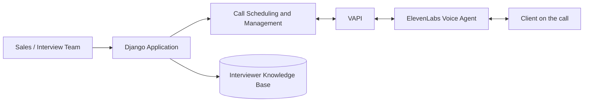
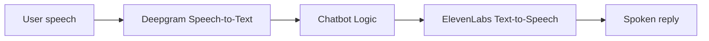

# Voice AI Sales Agent

A Django application that schedules and runs sales and interview calls through VAPI with ElevenLabs voice agents.

> **Note:** This is a client/private project. Source code is not public; this page summarizes the work.

## Overview

The Voice AI Sales Application is a Django app for scheduling and managing interview and sales calls through VAPI. It gives interviewers a knowledge base to work from and runs ElevenLabs voice agents for client conversations.

### Related work: Voice AI chatbot (Deepgram + ElevenLabs)

Separately, I built a voice AI chatbot that converts speech to text with Deepgram and returns natural spoken replies with ElevenLabs. It is included here because it uses the same speech-to-text and text-to-speech approach.

## Key features

- **Call scheduling**: schedule interview and sales calls through VAPI
- **Call management**: manage calls from inside the Django application
- **Interviewer knowledge base**: a knowledge base for interviewers to refer to
- **ElevenLabs voice agents**: AI voice agents that hold client conversations
- **Voice chatbot (related project)**: speech-to-text with Deepgram and natural spoken replies with ElevenLabs

## Tech stack

- **Language / framework:** Python, Django
- **Voice AI:** VAPI, ElevenLabs
- **Voice chatbot (related):** Deepgram (speech-to-text), ElevenLabs (text-to-speech)

## Architecture

**Voice AI Sales Application**

**Voice AI chatbot (related project)**

## My role

- Developed the Django application for scheduling and managing calls through VAPI
- Built the interviewer knowledge base
- Integrated ElevenLabs voice agents for client conversations
- Built the related voice chatbot pipeline with Deepgram and ElevenLabs

## Screenshots / demo

_Screenshots coming soon. A live walkthrough is available on request._

## Contact

